# NexStep — Complete Master Project Documentation

> **Document Version:** 2.0.0 (Consolidated Master Edition)  
> **Date of Audit:** October 2026  
> **Project Root:** `d:\antigravity\NexStep`  
> **Current Stage:** Stage 2 / Interrupted Midway  
> **Target Audience:** Developers, Technical Leads, and System Architects resuming development.

---

## Table of Contents
1. [1. Project Overview](#1-project-overview)
2. [2. Technology Stack & Dependencies](#2-technology-stack--dependencies)
3. [3. Project Folder Structure](#3-project-folder-structure)
4. [4. System Architecture](#4-system-architecture)
5. [5. Feature-by-Feature Detailed Documentation](#5-feature-by-feature-detailed-documentation)
6. [6. User Interface & Live Screenshots](#6-user-interface--live-screenshots)
7. [7. Database Documentation & Full Schema Specification](#7-database-documentation--full-schema-specification)
8. [8. REST API Documentation](#8-rest-api-documentation)
9. [9. Complete Application Workflows & User Journeys](#9-complete-application-workflows--user-journeys)
10. [10. Windows Setup, Execution & Troubleshooting Guide](#10-windows-setup-execution--troubleshooting-guide)
11. [11. Authentication, Security & Configuration](#11-authentication-security--configuration)
12. [12. Testing, Verification & Quality Report](#12-testing-verification--quality-report)
13. [13. Current Development Status](#13-current-development-status)
14. [14. Bugs, Code Inconsistencies & Technical Debt](#14-bugs-code-inconsistencies--technical-debt)
15. [15. Prioritized Development Continuation Roadmap](#15-prioritized-development-continuation-roadmap)
16. [16. First Session Guide: Exact Resumption Task](#16-first-session-guide-exact-resumption-task)
17. [17. Project Glossary](#17-project-glossary)
18. [18. Final Project Summary](#18-final-project-summary)

---

## 1. Project Overview

### 1.1 Project Name & Tagline
- **Project Name:** **NexStep**
- **Tagline:** AI-Powered Resume Matching & Career Discovery Platform

### 1.2 Purpose and Problem Statement
Modern technical job seekers face major hurdles during their job search:
1. **Resume Blindness:** Candidates submit resumes without knowing whether their listed skills align with the requirements of target software roles.
2. **Generic Keyword Matching:** Traditional job boards rely on rigid keyword searches that frequently miss qualified candidates or suggest irrelevant opportunities.
3. **Application Fragmentation:** Job seekers lack a centralized, local dashboard to parse their resumes, evaluate match probability scores, bookmark relevant positions, and monitor which company portals they have applied to.

NexStep solves this problem by providing an automated platform that:
- Ingests and parses candidate PDF resumes in-memory.
- Extracts technical skills, education history, and experience snippets.
- Runs natural language processing (TF-IDF vectorization) and a pre-trained machine learning classification model (`LogisticRegression`) to assess fit against software engineering job descriptions.
- Aggregates live job postings from real-world corporate job boards (Greenhouse and Lever), ranks them by calculated match score (0–98%), and allows candidates to bookmark jobs and track external application links.

### 1.3 Why the Project is Needed
Many candidates waste hundreds of hours applying to misaligned positions because they lack automated feedback on their resume content. NexStep bridges this gap by acting as an intelligent career copilot, giving candidates transparent mathematical confidence metrics ("Good Fit", "Potential Fit", "No Fit") and highlighting matched skill overlaps.

### 1.4 Target Users
- **Primary Users:** Software developers, engineers, data analysts, and tech job seekers looking for tailored opportunities and resume feedback.
- **Secondary Users:** Career switchers seeking to understand what technical skills they are missing for specific engineering roles.

### 1.5 Main Objectives
1. Provide a zero-friction, drag-and-drop resume upload experience.
2. Extract candidate contact info and technical skills using high-speed regex parsing.
3. Deliver model-backed fit predictions with probabilistic scoring.
4. Ingest and normalize live software job postings from public employer boards without requiring paid third-party job API subscriptions.
5. Provide a responsive, unified candidate dashboard for managing career recommendations.

### 1.6 Key Features
- **Interactive Landing Page Simulator:** Allows prospective users to test the matching concept without signing in.
- **Candidate Onboarding:** Clean registration and sign-in interfaces with password strength indicators and field validation.
- **In-Memory PDF Resume Parser:** Extracts text, page counts, and contact metadata from PDF files up to 10 MB.
- **Machine Learning Fit Classifier:** Evaluates resume text against job descriptions using a 200,000-feature TF-IDF matrix.
- **Live Multi-Source Job Aggregator:** Pulls live opportunities from Greenhouse and Lever APIs with automatic local fallback.
- **Dynamic Candidate Dashboard:** Real-time stat counters, SVG score ring gauges, and activity tracking.
- **Job Bookmarking & Application Tracking:** Seamless saving of opportunities and timestamped history of external application links opened.

### 1.7 Current Development Status
The project was paused at **Stage 2 / Interrupted Midway**:
- The **frontend presentation layer** is substantially built with 9 responsive HTML pages and a custom CSS design system.
- The **Flask backend API** is active and fully functional for job aggregation, PDF analysis, and ML inference.
- The **data persistence layer** is currently restricted to client-side browser storage (`localStorage` and `sessionStorage`). The planned **MySQL database** is entirely unimplemented (the `Database/` folder contains only a `.gitkeep` file).
- **Authentication** is currently client-side only; passwords are not sent to or verified by the backend.

### 1.8 What the Completed Project is Intended to Achieve
When fully completed, NexStep will be a secure, multi-tenant cloud application backed by a MySQL database, JWT authentication, persistent resume versioning, user-specific search filters, and an automated training pipeline to continually refine its machine learning matching accuracy.

---

## 2. Technology Stack & Dependencies

```mermaid
graph TD
    Client["Frontend Browser Client<br>(HTML5, CSS3, ES6 JavaScript)"]
    Server["Backend REST API<br>(Python 3.11, Flask 3.1, Flask-CORS)"]
    ML["Machine Learning Engine<br>(Scikit-Learn, PyPDF, Joblib)"]
    Storage["Data Storage<br>(Browser LocalStorage / Planned MySQL)"]
    External["External Public APIs<br>(Greenhouse & Lever Job Boards)"]

    Client <-->|HTTP / JSON (Ports 3000 -> 5000)| Server
    Server <--> ML
    Server <--> External
    Client <--> Storage
```

### 2.1 Technology Inventory & Verified Versions

| Category | Technology | Verified Version | Purpose & Rationale | Status in Project |
| :--- | :--- | :--- | :--- | :--- |
| **Runtime Environment** | Python | `3.11.15` | Core backend execution engine. | Active / Verified |
| **Runtime Environment** | Windows PowerShell | Windows 10/11 | Development scripting, runner orchestration, port management. | Active / Verified |
| **Backend Framework** | Flask | `3.1.3` | Lightweight Python WSGI web framework providing REST endpoints. | Active / Verified |
| **Backend Middleware** | Flask-CORS | `6.0.5` | Handles Cross-Origin Resource Sharing for API requests from port 3000 to port 5000. | Active / Verified |
| **WSGI / Utility** | Werkzeug | `3.1.8` | HTTP utility library underlying Flask. | Active / Verified |
| **Template Engine** | Jinja2 | `3.1.6` | Dependency of Flask (currently unused for rendering; API returns JSON). | Active (Dependency) |
| **Serialization** | Joblib | `1.6.0` | High-performance serialization/deserialization for large Scikit-Learn models and vectorizers. | Active / Verified |
| **Document Parsing** | PyPDF | `6.18.1` | Pure-Python PDF extraction library used to extract raw text and page counts from uploaded resumes. | Active / Verified |
| **Machine Learning** | Scikit-Learn | `1.9.1` | Machine learning library providing `LogisticRegression` and `TfidfVectorizer`. (*Model artifacts were trained under version 1.6.1*). | Active / Verified (With warning) |
| **Scientific Computing**| NumPy | `2.4.6` | Array manipulation and numerical operations supporting Scikit-Learn. | Active / Verified |
| **Scientific Computing**| SciPy | `1.17.1` | Scientific algorithms and sparse matrix data structures supporting TF-IDF. | Active / Verified |
| **Frontend Core** | HTML5 | Living Standard | Semantic document structures across 9 client pages. | Active / Verified |
| **Frontend Styling** | Vanilla CSS3 | Custom System | Zero-framework CSS architecture featuring custom design tokens, responsive grid/flexbox, glassmorphism, and animations (`css/style.css`). | Active / Verified |
| **Frontend Logic** | JavaScript (ES6+) | Standard | Client interactivity, API consumption via `fetch()`, drag-and-drop file handling, and reactive state management. | Active / Verified |
| **Typography** | Google Fonts | `Plus Jakarta Sans`, `Inter` | Modern typography loaded via Google CDN. | Active / Verified |
| **Iconography** | FontAwesome CDN | `6.4.0` | Vector icon library for UI navigation, badges, and status indicators. | Active / Verified |
| **Client Storage** | Web Storage API | `localStorage`, `sessionStorage` | Client-side persistence for user profile, resume analysis, bookmarks, and applications. | Active / Verified |
| **Job Aggregation** | Python `urllib.request` | Standard Library | Native HTTP request module used for fetching public Greenhouse and Lever job postings without external requests library. | Active / Verified |
| **Data Fallback** | JSON (`jobs.json`) | RFC 8259 | Local dataset containing 10 pre-curated software engineering listings. | Active / Verified |
| **Database** | MySQL | *Planned* | Planned relational database for multi-user persistence (not yet implemented; folder contains only `.gitkeep`). | Planned / Unimplemented |

### 2.2 In-Depth Component Analysis

#### A. Backend Layer (Python & Flask)
- **Why Flask?** Flask provides minimal overhead, fast startup time, and flexibility. Since NexStep operates primarily as an API provider returning JSON payloads to a decoupled frontend, Flask's lightweight blueprint is well-suited.
- **CORS Handling:** The frontend runs on `http://127.0.0.1:3000`, while the backend operates on `http://127.0.0.1:5000`. `flask-cors` ensures seamless cross-origin communication without browser security blocks.
- **Entry Point:** [Backend/app.py](file:///d:/antigravity/NexStep/Backend/app.py) configures the routes, loads the ML models once at startup, and initializes the service layer.

#### B. Machine Learning & NLP Pipeline
The ML pipeline operates at inference time in `Backend/app.py`:
1. **Document Ingestion:** [pypdf.PdfReader](file:///d:/antigravity/NexStep/Backend/app.py#L7) parses incoming multipart PDF uploads in-memory, extracting character streams without persisting binary data to disk.
2. **Text Normalization:** `clean_text_utf8()` replaces typographical quotation marks, en-dashes, and em-dashes to prevent encoding discrepancies.
3. **Keyword Vector Extraction:** `extract_skills_from_text()` queries a dictionary of 66 technical skills ([TECHNICAL_SKILLS_DICT](file:///d:/antigravity/NexStep/Backend/app.py#L38-L47)) covering languages, web frameworks, databases, cloud, and DevOps tools.
4. **TF-IDF Feature Representation:** [Backend/nexstep_tfidf.pkl](file:///d:/antigravity/NexStep/Backend/nexstep_tfidf.pkl) transforms combined candidate text and job descriptions into a 200,000-dimensional sparse TF-IDF matrix.
5. **Classification Model:** [Backend/nexstep_model.pkl](file:///d:/antigravity/NexStep/Backend/nexstep_model.pkl) is a `LogisticRegression` classifier configured with:
   - `penalty='l2'`
   - `solver='liblinear'`
   - `class_weight='balanced'`
   - `max_iter=1000`
   - Target Classes: `['Good Fit', 'No Fit', 'Potential Fit']`
6. **Skill Boost Scoring:** Combined recommendation scores blend the probabilistic output of `predict_proba()` for "Good Fit" with an overlap boost of 12% per matched keyword (capped at 50%), resulting in a final score between 0% and 98%.

#### C. Frontend Layer (Vanilla Web Architecture)
- **Why Vanilla Technologies?** Avoiding heavy frontend frameworks (React, Vue, Angular) eliminates compile/build steps (`npm run build`, Webpack/Vite bundlers), allowing immediate browser execution via any static web server (`python -m http.server`).
- **Design System:** [Frontend/css/style.css](file:///d:/antigravity/NexStep/Frontend/css/style.css) defines CSS custom properties (variables) for consistent themes:
  - Primary Brand: Deep Forest Teal (`#245E55`, `#1D4C44`)
  - Accent / Warm: Warm Ochre Gold (`#EAC119`)
  - Neutral Backgrounds: Off-white Seashell (`#FBFBF9`, `#F4F4F0`)
  - Text: Slate charcoal (`#1D1D1B`, `#334155`, `#64748B`)
- **State Management:** [Frontend/js/state.js](file:///d:/antigravity/NexStep/Frontend/js/state.js) implements the `NexStepState` singleton. It provides methods for getting and setting user profile data, active analysis results, saved job bookmarks, application histories, and recent activity logs. It also enforces HTML sanitization against potential script injection.

#### D. Third-Party Integrations
1. **Greenhouse Job Board API:**
   - Endpoint pattern: `https://boards-api.greenhouse.io/v1/boards/{board_token}/jobs?content=true`
   - Default monitored boards: `gitlab`, `cloudflare`, `canonical`, `figma`
   - Response parsing: Extracts title, company, location, HTML-cleaned job description, and application URL.
2. **Lever Postings API:**
   - Endpoint pattern: `https://api.lever.co/v0/postings/{company}?mode=json`
   - Default monitored companies: `lever`, `netflix`, `figma`
   - Response parsing: Extracts commitment (full-time/part-time), plain-text descriptions, lists, and hosted application links.
3. **Local Fallback Data:**
   - [Backend/jobs.json](file:///d:/antigravity/NexStep/Backend/jobs.json) provides 10 pre-defined software roles used when external APIs are unreachable or offline.

---

## 3. Project Folder Structure

```text
d:\antigravity\NexStep\
│
├── .gitignore                     # Git ignore rules for Python, venv, and IDE files
├── README.md                      # High-level overview and run instructions
├── run.py                         # Windows runner script (launches frontend & backend)
│
├── Backend/                       # Flask API and ML Service
│   ├── app.py                     # Main Flask application with API endpoints
│   ├── job_service.py             # Central job aggregation, normalization & caching
│   ├── jobs.json                  # Fallback demo job listings (10 positions)
│   ├── requirements.txt           # Python dependency file (currently incomplete)
│   ├── nexstep_classes.pkl        # Serialized classification target labels
│   ├── nexstep_model.pkl          # Serialized LogisticRegression classifier (~4.8 MB)
│   ├── nexstep_tfidf.pkl          # Serialized TfidfVectorizer (~9.05 MB)
│   └── job_sources/               # Ingestion source adapters
│       ├── __init__.py            # Package initializer
│       ├── greenhouse.py          # Greenhouse public board scraper & HTML sanitizer
│       ├── lever.py               # Lever public API scraper & list parser
│       └── local.py               # Fallback loader for jobs.json
│
├── Frontend/                      # Client-side presentation layer
│   ├── index.html                 # Public landing page with hero & live simulator
│   ├── login.html                 # Candidate sign-in interface
│   ├── register.html              # Candidate registration interface
│   ├── dashboard.html             # Main candidate overview dashboard
│   ├── upload.html                # PDF resume drag-and-drop upload portal
│   ├── analysis.html              # Resume analysis breakdown & ML score details
│   ├── jobs.html                  # Ranked job recommendations feed
│   ├── saved.html                 # Bookmarked opportunities screen
│   ├── applications.html          # External application click tracking log
│   │
│   ├── css/
│   │   └── style.css              # Unified global stylesheet (39 KB)
│   │
│   └── js/
│       ├── config.js              # Central API configuration (API_BASE_URL)
│       ├── state.js               # Central State Manager (NexStepState & localStorage)
│       ├── script.js              # Landing page interactivity & demo simulation
│       ├── auth.js                # Form validation & client-side profile saving
│       ├── dashboard.js           # Dashboard rendering & live recommendations preview
│       ├── upload.js              # Drag-and-drop validation & multipart POST to API
│       ├── analysis.js            # Dynamic rendering of extracted skills & score gauge
│       ├── jobs.js                # Recommendations rendering, saving & tracking
│       ├── saved.js               # Saved jobs display and removal logic
│       └── applications.js        # Application history table rendering
│
├── Database/                      # Database configuration directory
│   └── .gitkeep                   # Placeholder (MySQL schema not yet implemented)
│
├── ML/                            # Machine learning scripts & training data
│   └── .gitkeep                   # Placeholder (Training scripts not yet committed)
│
├── uploads/                       # File storage directory
│   └── .gitkeep                   # Placeholder (PDFs are currently processed in-memory)
│
└── docs/                          # Consolidated Project Documentation Suite
    ├── PROJECT_DOCUMENTATION.md   # This master single-document documentation
    └── screenshots/               # Verified live application screenshots (9 PNGs)
        ├── landing_page.png
        ├── login.png
        ├── register.png
        ├── dashboard.png
        ├── resume_upload.png
        ├── resume_analysis.png
        ├── job_recommendations.png
        ├── saved_jobs.png
        └── applications_activity.png
```

---

## 4. System Architecture

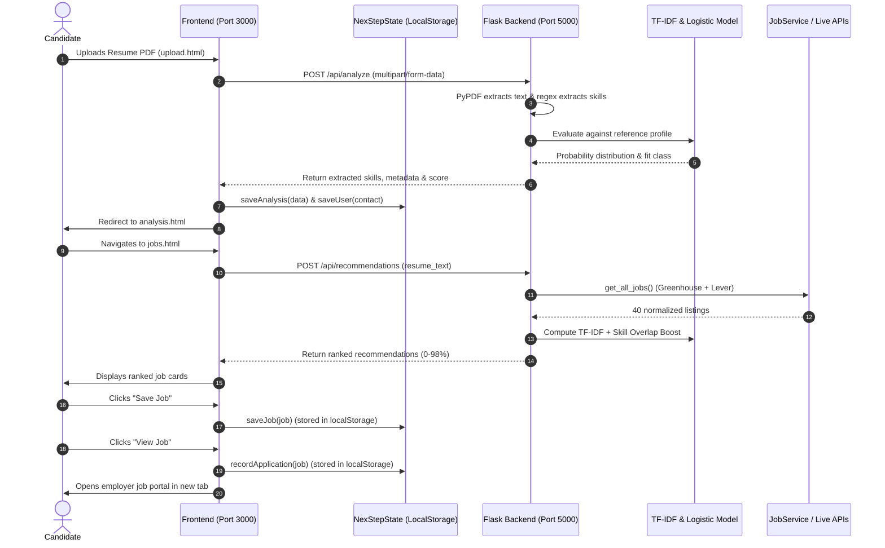

### Architecture Breakdown
1. **Frontend Architecture:** Static HTML/JS application served on port 3000. It makes asynchronous HTTP `fetch()` requests to the backend API on port 5000 and synchronizes state via `NexStepState`.
2. **Backend Architecture:** REST API structured with Flask. It routes requests, orchestrates model inference, coordinates the job service, and enforces CORS policies.
3. **Inference Pipeline:** Executes entirely in-memory using Scikit-Learn. TF-IDF transforms combined text strings, and Logistic Regression outputs probability scores across the 3 target classes.
4. **Job Ingestion Architecture:** Leverages standard library `urllib.request` to poll public Greenhouse and Lever APIs. Responses are cleaned of raw HTML tags, normalized into canonical dictionary structures, and held in an in-memory 15-minute cache.

---

## 5. Feature-by-Feature Detailed Documentation

### Feature 1: Public Landing Page & Interactive Simulator
- **Purpose:** Introduce the platform value proposition and demonstrate resume parsing and matching to prospective users without requiring account creation.
- **Access Route:** `http://127.0.0.1:3000/` or `Frontend/index.html`.
- **Files Involved:** [Frontend/index.html](file:///d:/antigravity/NexStep/Frontend/index.html), [Frontend/css/style.css](file:///d:/antigravity/NexStep/Frontend/css/style.css), [Frontend/js/script.js](file:///d:/antigravity/NexStep/Frontend/js/script.js).
- **Backend Endpoints:** None (Runs client-side simulation).
- **How It Works:** Users click role pills (Software Developer, Data Scientist, Frontend Engineer) or drop a file. A simulated progress bar advances, extracting mock technical skills and displaying corresponding match cards.
- **Status:** **Implemented & Fully Functional.**
- **Known Limitations:** The simulator produces pre-programmed mock results rather than querying the real backend API.

### Feature 2: Candidate Authentication (Login & Register)
- **Purpose:** Onboard candidates, capture full name and email, and establish a personalized session.
- **Access Route:** `http://127.0.0.1:3000/login.html` and `register.html`.
- **Files Involved:** [Frontend/login.html](file:///d:/antigravity/NexStep/Frontend/login.html), [Frontend/register.html](file:///d:/antigravity/NexStep/Frontend/register.html), [Frontend/js/auth.js](file:///d:/antigravity/NexStep/Frontend/js/auth.js), [Frontend/js/state.js](file:///d:/antigravity/NexStep/Frontend/js/state.js).
- **Backend Endpoints:** None.
- **How It Works:** Forms validate email format, password minimum length (8 characters), password strength meter (scoring numbers, uppercase, and symbols), password confirmation matching, and terms acceptance. On submit, candidate metadata is written directly to `localStorage.nexstepUserProfile` and the browser redirects to the dashboard.
- **Status:** **Partially Implemented.**
- **Known Limitations:** **No backend authentication exists.** Passwords are not hashed, verified, or stored in a database. Any email and password passing client-side regex allows sign-in.

### Feature 3: Candidate Overview Dashboard
- **Purpose:** Provide a centralized command center displaying active resume status, match score gauges, extracted skill chips, stat counters, and quick recommendation previews.
- **Access Route:** `http://127.0.0.1:3000/dashboard.html`.
- **Files Involved:** [Frontend/dashboard.html](file:///d:/antigravity/NexStep/Frontend/dashboard.html), [Frontend/js/dashboard.js](file:///d:/antigravity/NexStep/Frontend/js/dashboard.js), [Frontend/js/state.js](file:///d:/antigravity/NexStep/Frontend/js/state.js).
- **Backend Endpoints:** `POST /api/recommendations` (loads top 3 preview matches if a resume is active).
- **How It Works:** On load, `dashboard.js` queries `NexStepState` to populate the candidate name, resume status, skill count, saved jobs count, and application count. It animates an SVG circular ring gauge representing match score probability and asynchronously requests the top 3 job matches from the API.
- **Status:** **Implemented & Fully Functional.**
- **Known Limitations:** If no resume has been uploaded in the current session, it displays helpful empty states prompting the user to upload one.

### Feature 4: Resume PDF Upload & Text Parsing
- **Purpose:** Allow candidates to upload their PDF resume, extract text content in-memory, and extract entity metadata.
- **Access Route:** `http://127.0.0.1:3000/upload.html`.
- **Files Involved:** [Frontend/upload.html](file:///d:/antigravity/NexStep/Frontend/upload.html), [Frontend/js/upload.js](file:///d:/antigravity/NexStep/Frontend/js/upload.js), [Backend/app.py:186-256](file:///d:/antigravity/NexStep/Backend/app.py#L186-L256).
- **Backend Endpoints:** `POST /api/analyze`.
- **How It Works:** Dropzone accepts PDF files under 10 MB. Clicking "Continue to Analysis" posts a `FormData` payload containing the binary file to `/api/analyze`. `pypdf.PdfReader` extracts text across all pages. Regular expressions extract candidate name, email, skills from a 66-keyword dictionary, and education/experience snippets. The API response is saved to `NexStepState` and the user is redirected to `analysis.html`.
- **Status:** **Implemented & Verified.**
- **Known Limitations:** Only supports PDF files (DOCX is not supported). Binary PDFs are not saved to disk on the server.

### Feature 5: AI/ML Resume Alignment Analysis
- **Purpose:** Display a detailed visual breakdown of extracted resume content and ML classification probabilities.
- **Access Route:** `http://127.0.0.1:3000/analysis.html`.
- **Files Involved:** [Frontend/analysis.html](file:///d:/antigravity/NexStep/Frontend/analysis.html), [Frontend/js/analysis.js](file:///d:/antigravity/NexStep/Frontend/js/analysis.js).
- **Backend Endpoints:** Consumes data saved by `POST /api/analyze`.
- **How It Works:** Reads active analysis data from `NexStepState`. Dynamically renders skill chips, education timelines, experience snippets, and a probability breakdown card showing percentages for "Good Fit", "Potential Fit", and "No Fit".
- **Status:** **Implemented & Fully Functional.**
- **Known Limitations:** If user visits `analysis.html` directly without uploading a resume, an empty state card is displayed.

### Feature 6: Live Job Recommendations & Match Scoring
- **Purpose:** Display ranked software engineering job listings matched specifically to the candidate's extracted resume text.
- **Access Route:** `http://127.0.0.1:3000/jobs.html`.
- **Files Involved:** [Frontend/jobs.html](file:///d:/antigravity/NexStep/Frontend/jobs.html), [Frontend/js/jobs.js](file:///d:/antigravity/NexStep/Frontend/js/jobs.js), [Backend/app.py:262-346](file:///d:/antigravity/NexStep/Backend/app.py#L262-L346), [Backend/job_service.py](file:///d:/antigravity/NexStep/Backend/job_service.py).
- **Backend Endpoints:** `POST /api/recommendations`.
- **How It Works:** Sends extracted resume text to the backend. The backend fetches active jobs from Greenhouse and Lever (or fallback demo jobs), evaluates each using the TF-IDF vectorizer + Logistic Regression, adds a direct keyword overlap boost (+12% per matched skill up to +50%), sorts results descending by score, and returns top opportunities.
- **Status:** **Implemented & Verified.**
- **Known Limitations:** No user-facing keyword search or location filter dropdowns on the frontend yet.

### Feature 7: Saved Jobs Bookmarking
- **Purpose:** Enable candidates to save interesting jobs to review later.
- **Access Route:** `http://127.0.0.1:3000/saved.html`.
- **Files Involved:** [Frontend/saved.html](file:///d:/antigravity/NexStep/Frontend/saved.html), [Frontend/js/saved.js](file:///d:/antigravity/NexStep/Frontend/js/saved.js), [Frontend/js/state.js](file:///d:/antigravity/NexStep/Frontend/js/state.js).
- **Backend Endpoints:** None (Client-side persistence).
- **How It Works:** Clicking "Save Job" on any card invokes `NexStepState.saveJob()`, storing or removing the job from `localStorage.nexstepSavedJobsList`. `saved.html` reads this array and renders bookmark cards with a "Remove" button.
- **Status:** **Implemented & Fully Functional.**
- **Known Limitations:** Bookmarks are local to the current browser and do not synchronize to a server database.

### Feature 8: External Application Activity Tracking
- **Purpose:** Automatically track when a candidate clicks through to apply to a job on an employer's official portal.
- **Access Route:** `http://127.0.0.1:3000/applications.html`.
- **Files Involved:** [Frontend/applications.html](file:///d:/antigravity/NexStep/Frontend/applications.html), [Frontend/js/applications.js](file:///d:/antigravity/NexStep/Frontend/js/applications.js), [Frontend/js/state.js](file:///d:/antigravity/NexStep/Frontend/js/state.js).
- **Backend Endpoints:** None.
- **How It Works:** When a user clicks "View Job" on any job card, `NexStepState.recordApplication()` logs the job ID, company, role title, destination URL, and timestamp into `localStorage.nexstepApplicationsList`, and opens the external URL in a new tab. `applications.html` displays this history in an organized data table.
- **Status:** **Implemented & Fully Functional.**
- **Known Limitations:** State is stored locally; status is recorded as "External Application" without direct ATS webhook feedback.

---

## 6. User Interface & Live Screenshots

All 9 screenshots below were captured directly from the **live running application** on Windows using headless Chrome:

### 1. Landing Page (`index.html`)
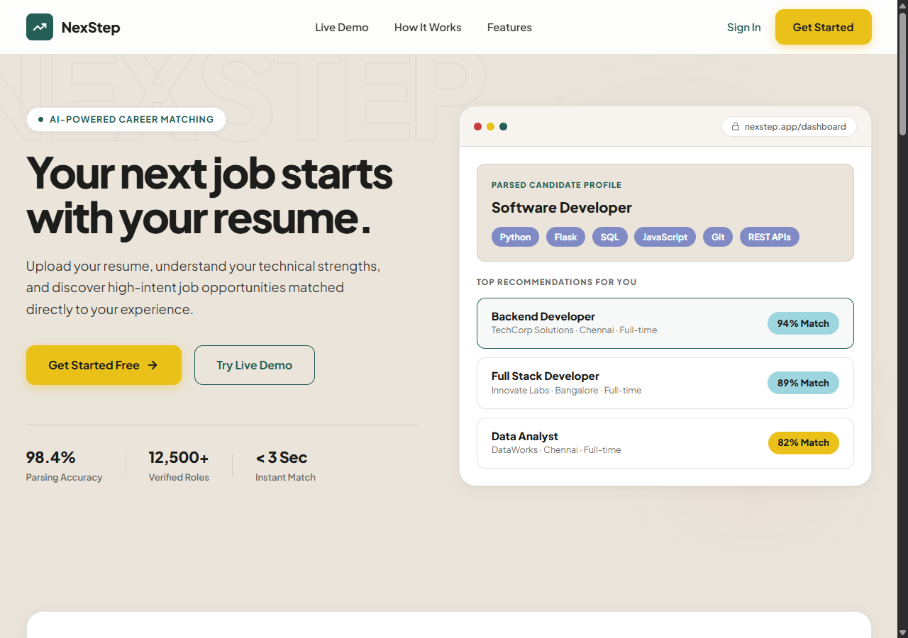
*Figure 1: The NexStep homepage featuring the hero section, value proposition, parsing accuracy metrics, and navigation.*

---

### 2. Candidate Sign In (`login.html`)
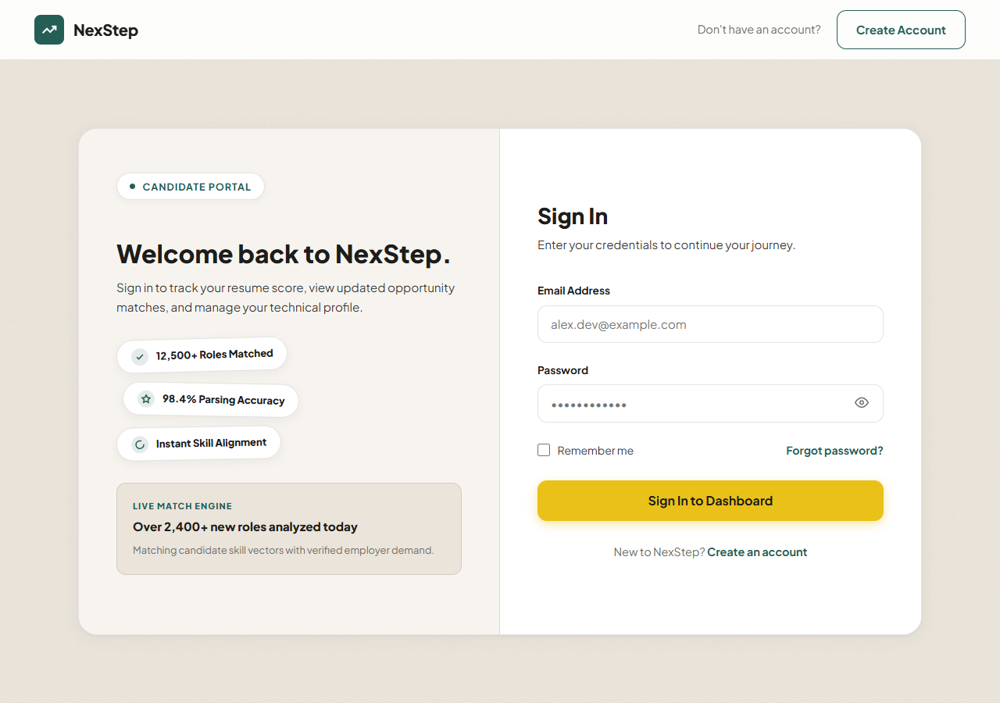
*Figure 2: The candidate login screen with input validation, password toggle, and live match statistics.*

---

### 3. Candidate Registration (`register.html`)
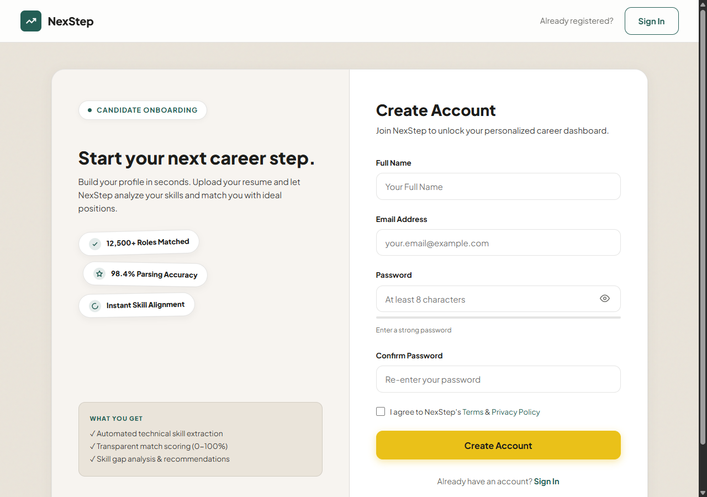
*Figure 3: The registration portal with dynamic password strength meter, password match validation, and onboarding checklist.*

---

### 4. Candidate Dashboard (`dashboard.html`)
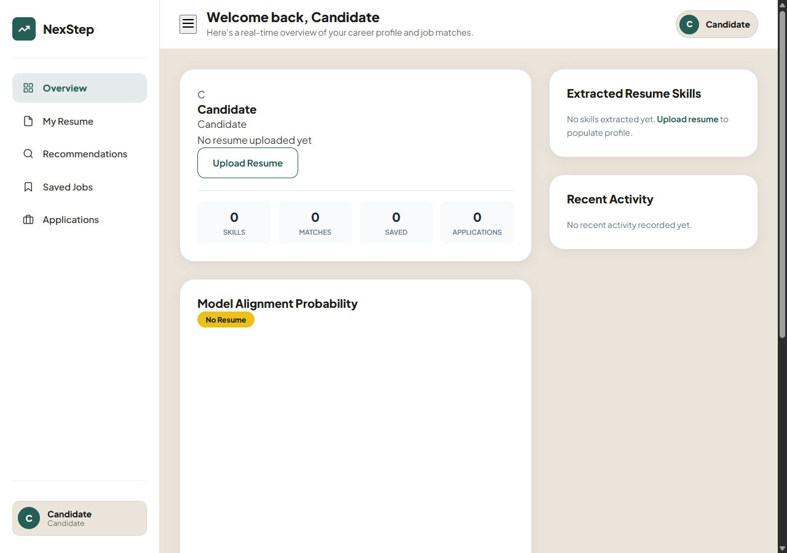
*Figure 4: The candidate command center displaying real-time stat counters, circular SVG score ring gauge, active resume status, and activity history.*

---

### 5. Resume Upload Portal (`upload.html`)
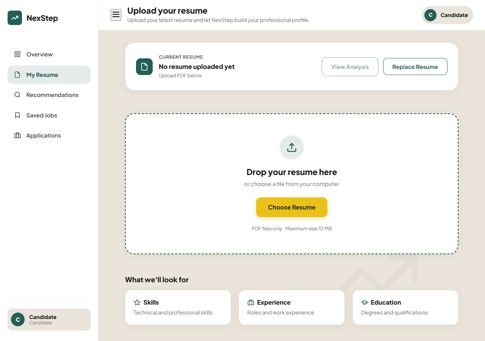
*Figure 5: Drag-and-drop resume upload zone with client-side file size and format validation (PDF <= 10MB).*

---

### 6. Resume Analysis Breakdown (`analysis.html`)
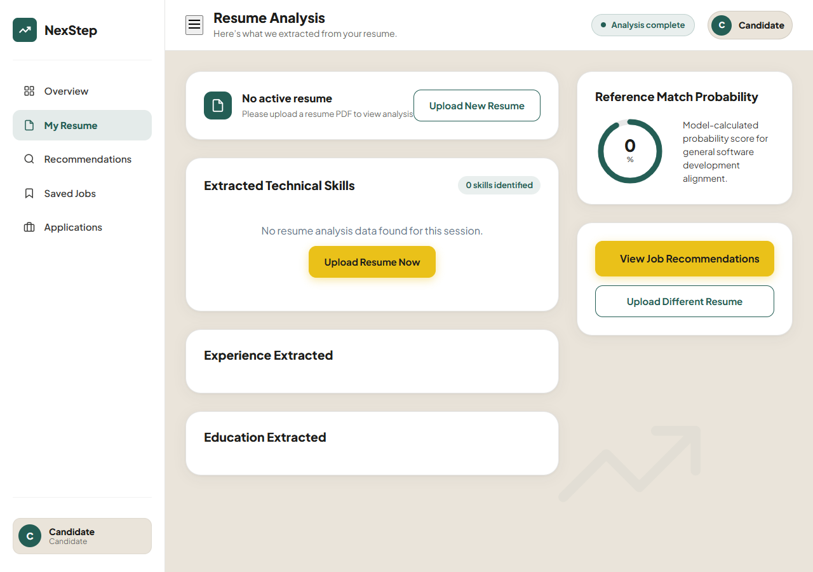
*Figure 6: Detailed resume analysis screen displaying extracted skills chips, qualification history, and ML probability distribution.*

---

### 7. Job Recommendations (`jobs.html`)
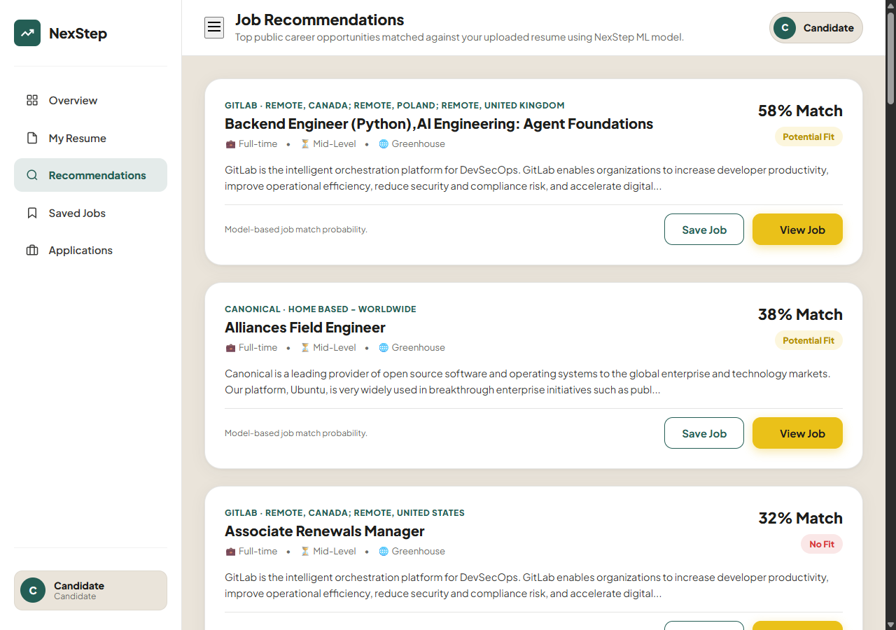
*Figure 7: Live job recommendations feed ranked by TF-IDF model match score, fit classification pills, and bookmarking controls.*

---

### 8. Saved Jobs (`saved.html`)
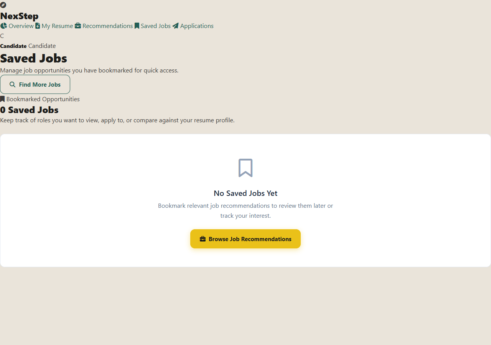
*Figure 8: Saved jobs screen showing bookmarked opportunities with quick access to external applications.*

---

### 9. Application Activity Log (`applications.html`)
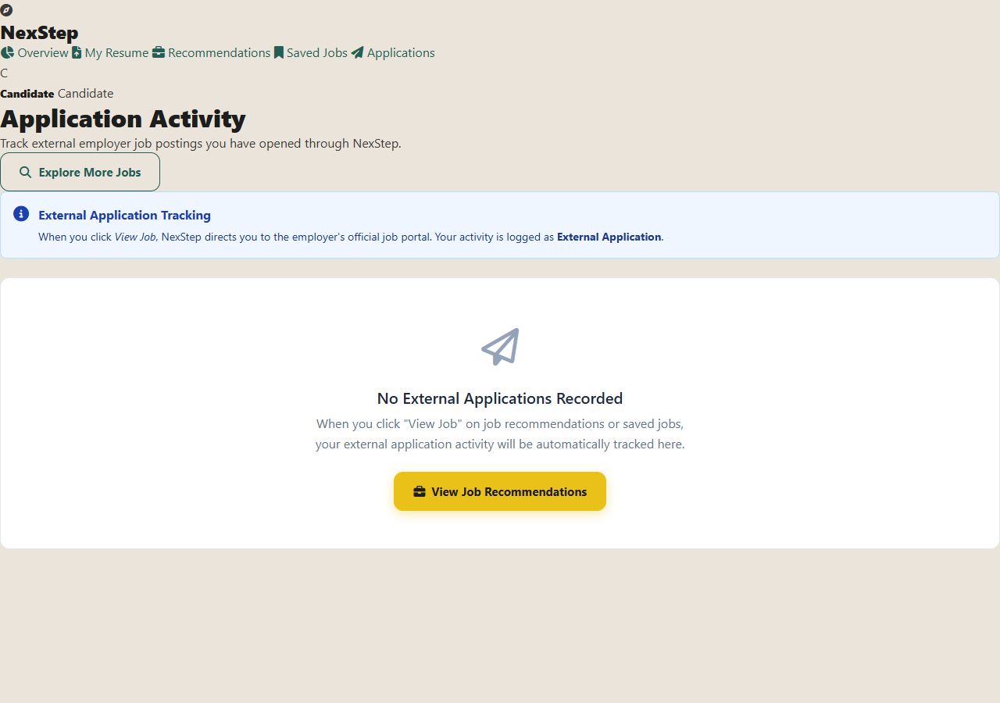
*Figure 9: Application activity audit table tracking external employer links opened with date and time stamps.*

---

## 7. Database Documentation & Full Schema Specification

### 7.1 Current State vs. Target State

#### Current Implementation (Client-Side State Storage)
- **Database Engine:** *None implemented.* The [Database/](file:///d:/antigravity/NexStep/Database/) folder contains only a `.gitkeep` placeholder file.
- **Persistence Mechanism:** The browser's Web Storage API (`localStorage` and `sessionStorage`) is managed through the central state manager ([Frontend/js/state.js](file:///d:/antigravity/NexStep/Frontend/js/state.js)).
- **Scope:** State is bound to the candidate's local browser instance. Data does not synchronize across devices, browsers, or user sessions.

#### Planned Production Implementation (Relational Database)
- **Planned Engine:** MySQL 8.0+ / MariaDB.
- **ORM / Driver Options:** SQLAlchemy, Flask-SQLAlchemy, or PyMySQL.
- **Objective:** Support multi-user accounts, secure credential storage, persistent resume history, server-side job bookmarks, and analytics.

---

### 7.2 Current Client-Side State Schema (`NexStepState`)

The client stores 5 primary JSON keys in browser storage:

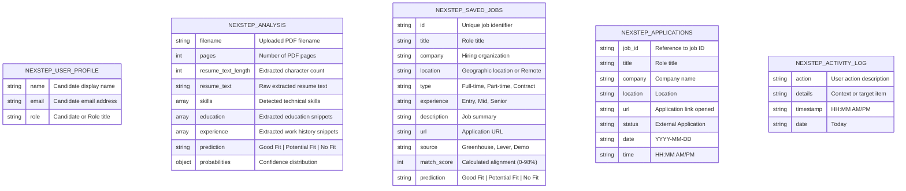

#### Storage Key Details:
1. `nexstepUserProfile` (`localStorage`):
   ```json
   {
     "name": "Alex Morgan",
     "email": "alex.morgan@example.com",
     "role": "Candidate"
   }
   ```
2. `nexstepAnalysis` (`sessionStorage` with `localStorage` backup):
   ```json
   {
     "filename": "Alex_Morgan_Resume.pdf",
     "pages": 1,
     "resume_text_length": 2184,
     "resume_text": "Alex Morgan ... Full Stack Engineer ...",
     "skills": ["Python", "Flask", "SQL", "MySQL", "JavaScript", "React", "Docker", "Git"],
     "education": ["B.S. in Computer Science - University of Technology"],
     "experience": ["Backend Engineer - CloudSolutions (2022-Present)"],
     "prediction": "Good Fit",
     "probabilities": {
       "Good Fit": 84.5,
       "Potential Fit": 11.2,
       "No Fit": 4.3
     }
   }
   ```
3. `nexstepSavedJobsList` (`localStorage`): Array of bookmarked job objects.
4. `nexstepApplicationsList` (`localStorage`): Array of recorded external application clicks.
5. `nexstepActivityLog` (`localStorage`): Array of recent user actions (capped at 15 items).

---

### 7.3 Recommended Production MySQL Relational Schema

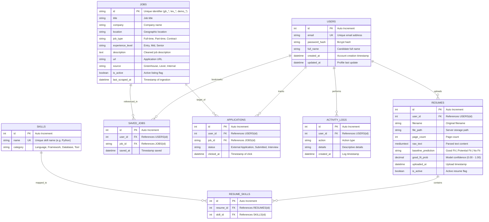

---

### 7.4 SQL Table Definitions (DDL)

```sql
-- 1. Users Table
CREATE TABLE users (
    id INT AUTO_INCREMENT PRIMARY KEY,
    email VARCHAR(255) NOT NULL UNIQUE,
    password_hash VARCHAR(255) NOT NULL,
    full_name VARCHAR(150) NOT NULL,
    role VARCHAR(50) DEFAULT 'Candidate',
    created_at TIMESTAMP DEFAULT CURRENT_TIMESTAMP,
    updated_at TIMESTAMP DEFAULT CURRENT_TIMESTAMP ON UPDATE CURRENT_TIMESTAMP,
    INDEX idx_user_email (email)
) ENGINE=InnoDB DEFAULT CHARSET=utf8mb4 COLLATE=utf8mb4_unicode_ci;

-- 2. Resumes Table
CREATE TABLE resumes (
    id INT AUTO_INCREMENT PRIMARY KEY,
    user_id INT NOT NULL,
    filename VARCHAR(255) NOT NULL,
    file_path VARCHAR(500) NULL,
    page_count INT DEFAULT 1,
    raw_text MEDIUMTEXT NOT NULL,
    baseline_prediction VARCHAR(50) NOT NULL,
    good_fit_prob DECIMAL(5, 4) NOT NULL,
    is_active BOOLEAN DEFAULT TRUE,
    uploaded_at TIMESTAMP DEFAULT CURRENT_TIMESTAMP,
    FOREIGN KEY (user_id) REFERENCES users(id) ON DELETE CASCADE,
    INDEX idx_resume_user (user_id)
) ENGINE=InnoDB DEFAULT CHARSET=utf8mb4 COLLATE=utf8mb4_unicode_ci;

-- 3. Skills Master Table
CREATE TABLE skills (
    id INT AUTO_INCREMENT PRIMARY KEY,
    name VARCHAR(100) NOT NULL UNIQUE,
    category VARCHAR(100) DEFAULT 'General',
    INDEX idx_skill_name (name)
) ENGINE=InnoDB DEFAULT CHARSET=utf8mb4 COLLATE=utf8mb4_unicode_ci;

-- 4. Resume to Skills Association
CREATE TABLE resume_skills (
    id INT AUTO_INCREMENT PRIMARY KEY,
    resume_id INT NOT NULL,
    skill_id INT NOT NULL,
    FOREIGN KEY (resume_id) REFERENCES resumes(id) ON DELETE CASCADE,
    FOREIGN KEY (skill_id) REFERENCES skills(id) ON DELETE CASCADE,
    UNIQUE KEY uq_resume_skill (resume_id, skill_id)
) ENGINE=InnoDB DEFAULT CHARSET=utf8mb4 COLLATE=utf8mb4_unicode_ci;

-- 5. Jobs Table
CREATE TABLE jobs (
    id VARCHAR(100) PRIMARY KEY,
    title VARCHAR(255) NOT NULL,
    company VARCHAR(255) NOT NULL,
    location VARCHAR(255) DEFAULT 'Remote',
    job_type VARCHAR(100) DEFAULT 'Full-time',
    experience_level VARCHAR(100) DEFAULT 'Mid-Level',
    description MEDIUMTEXT NOT NULL,
    url VARCHAR(1000) NOT NULL,
    source VARCHAR(100) DEFAULT 'Greenhouse',
    is_active BOOLEAN DEFAULT TRUE,
    last_scraped_at TIMESTAMP DEFAULT CURRENT_TIMESTAMP,
    INDEX idx_job_company (company),
    INDEX idx_job_title (title)
) ENGINE=InnoDB DEFAULT CHARSET=utf8mb4 COLLATE=utf8mb4_unicode_ci;

-- 6. Saved Jobs (Bookmarks)
CREATE TABLE saved_jobs (
    id INT AUTO_INCREMENT PRIMARY KEY,
    user_id INT NOT NULL,
    job_id VARCHAR(100) NOT NULL,
    saved_at TIMESTAMP DEFAULT CURRENT_TIMESTAMP,
    FOREIGN KEY (user_id) REFERENCES users(id) ON DELETE CASCADE,
    FOREIGN KEY (job_id) REFERENCES jobs(id) ON DELETE CASCADE,
    UNIQUE KEY uq_user_job (user_id, job_id)
) ENGINE=InnoDB DEFAULT CHARSET=utf8mb4 COLLATE=utf8mb4_unicode_ci;

-- 7. Application Tracking
CREATE TABLE applications (
    id INT AUTO_INCREMENT PRIMARY KEY,
    user_id INT NOT NULL,
    job_id VARCHAR(100) NOT NULL,
    status VARCHAR(100) DEFAULT 'External Application',
    clicked_at TIMESTAMP DEFAULT CURRENT_TIMESTAMP,
    FOREIGN KEY (user_id) REFERENCES users(id) ON DELETE CASCADE,
    FOREIGN KEY (job_id) REFERENCES jobs(id) ON DELETE CASCADE,
    INDEX idx_app_user (user_id)
) ENGINE=InnoDB DEFAULT CHARSET=utf8mb4 COLLATE=utf8mb4_unicode_ci;

-- 8. Activity Log
CREATE TABLE activity_logs (
    id INT AUTO_INCREMENT PRIMARY KEY,
    user_id INT NOT NULL,
    action VARCHAR(150) NOT NULL,
    details VARCHAR(500) NULL,
    created_at TIMESTAMP DEFAULT CURRENT_TIMESTAMP,
    FOREIGN KEY (user_id) REFERENCES users(id) ON DELETE CASCADE,
    INDEX idx_activity_user (user_id)
) ENGINE=InnoDB DEFAULT CHARSET=utf8mb4 COLLATE=utf8mb4_unicode_ci;
```

---

### 7.5 Migration Strategy from Client State to MySQL
1. **Step 1 — Database Provisioning:** Install and configure MySQL 8.0 locally or on a cloud instance; run the DDL schema above.
2. **Step 2 — Backend ORM Integration:** Add `SQLAlchemy` or `peewee` to `Backend/requirements.txt`. Create a database connection pool in `Backend/db.py`.
3. **Step 3 — User Registration Endpoint:** Implement `POST /api/auth/register` using `bcrypt` for password hashing.
4. **Step 4 — JWT Session Management:** Implement `flask-jwt-extended` to issue access tokens on `POST /api/auth/login`.
5. **Step 5 — State Migration API:** Create a client sync endpoint (`POST /api/sync`) that sends existing `localStorage` data (saved jobs, applications, profile) to the database upon first account creation or login.

---

## 8. REST API Documentation

### 8.1 API Architecture & General Conventions
- **Base URL (Local):** `http://127.0.0.1:5000`
- **Frontend Consumer:** [Frontend/js/config.js](file:///d:/antigravity/NexStep/Frontend/js/config.js) defines `CONFIG.API_BASE_URL`.
- **CORS Support:** Enabled globally across all routes via `flask_cors.CORS(app)`.
- **Content Types:**
  - Standard JSON requests: `Content-Type: application/json`
  - File upload requests: `Content-Type: multipart/form-data`
- **Authentication:** Currently **None** (Endpoints are publicly accessible without API keys or authorization headers).

---

### 8.2 API Endpoint Directory

| Method | Endpoint | Purpose | Request Format | Status |
| :--- | :--- | :--- | :--- | :--- |
| `GET` | `/` | Health check and ML model classes inspection | None | **Verified (200 OK)** |
| `GET` | `/api/jobs` | Retrieve all cached and aggregated job listings | None | **Verified (200 OK)** |
| `GET` | `/api/jobs/<job_id>` | Retrieve a single job listing by unique identifier | Path Parameter | **Verified (200 OK)** |
| `POST` | `/api/predict` | Predict match classification for raw text resume and JD | JSON body | **Verified (200 OK)** |
| `POST` | `/api/analyze` | Parse PDF resume, extract entities, evaluate alignment | Multipart Form | **Verified (200 OK)** |
| `POST` | `/api/recommendations`| Match resume text against all active jobs and return ranked scores | JSON body | **Verified (200 OK)** |

---

### 8.3 Detailed Endpoint Specifications

#### 1. Root Health Check & Model Info
- **Route:** `GET /`
- **Source File:** [Backend/app.py:121-127](file:///d:/antigravity/NexStep/Backend/app.py#L121-L127)
- **Description:** Returns the operational status of the Flask backend and the active classes recognized by the loaded machine learning model.
- **Request Parameters:** None.
- **Response Headers:** `Content-Type: application/json`
- **Response (200 OK):**
```json
{
  "message": "NexStep backend is running",
  "model_classes": [
    "Good Fit",
    "No Fit",
    "Potential Fit"
  ],
  "status": "success"
}
```

---

#### 2. Get All Jobs
- **Route:** `GET /api/jobs`
- **Source File:** [Backend/app.py:133-140](file:///d:/antigravity/NexStep/Backend/app.py#L133-L140)
- **Description:** Fetches all jobs aggregated by [Backend/job_service.py](file:///d:/antigravity/NexStep/Backend/job_service.py). This queries live Greenhouse and Lever job boards, normalizes their payloads, and caches results for 15 minutes (900 seconds). If external endpoints fail, it returns static fallback jobs from [Backend/jobs.json](file:///d:/antigravity/NexStep/Backend/jobs.json).
- **Request Parameters:** None.
- **Response (200 OK):**
```json
{
  "success": true,
  "total": 40,
  "jobs": [
    {
      "id": "gh_gitlab_123456",
      "title": "Backend Engineer, Ecosystem",
      "company": "Gitlab",
      "location": "Remote, Global",
      "type": "Full-time",
      "experience": "Mid-Level",
      "description": "GitLab is looking for a Backend Engineer...",
      "url": "https://boards.greenhouse.io/gitlab/jobs/123456",
      "source": "Greenhouse",
      "updated_at": "2026-10-18",
      "is_demo": false
    }
  ]
}
```

---

#### 3. Get Job By ID
- **Route:** `GET /api/jobs/<job_id>`
- **Source File:** [Backend/app.py:142-150](file:///d:/antigravity/NexStep/Backend/app.py#L142-L150)
- **Description:** Returns details for a specific job matching `<job_id>`.
- **Path Parameters:**
  - `job_id` (string, required): The unique identifier of the job (e.g., `gh_gitlab_123456` or `1`).
- **Response (200 OK):**
```json
{
  "success": true,
  "job": {
    "id": "1",
    "title": "Python Developer",
    "company": "TechNova Solutions",
    "location": "Chennai, Tamil Nadu",
    "type": "Full-time",
    "experience": "0-2 years",
    "description": "We are looking for a Python Developer...",
    "url": "#",
    "source": "Demo Dataset",
    "updated_at": "2026-09-01",
    "is_demo": true
  }
}
```
- **Error Response (404 Not Found):**
```json
{
  "error": "Job not found"
}
```

---

#### 4. Raw Text Match Prediction
- **Route:** `POST /api/predict`
- **Source File:** [Backend/app.py:156-180](file:///d:/antigravity/NexStep/Backend/app.py#L156-L180)
- **Description:** Evaluates a raw resume text against a raw job description using the TF-IDF vectorizer and Logistic Regression classifier.
- **Request Headers:** `Content-Type: application/json`
- **Request Body:**
```json
{
  "resume": "Software engineer with 4 years Python, Flask, SQL, and Docker experience.",
  "job_description": "Seeking Python backend developer with REST API and SQL knowledge."
}
```
- **Response (200 OK):**
```json
{
  "prediction": "Good Fit",
  "probabilities": {
    "Good Fit": 87.45,
    "Potential Fit": 9.12,
    "No Fit": 3.43
  }
}
```
- **Error Responses:**
  - `400 Bad Request`: `{ "error": "JSON data is required" }` or `{ "error": "Resume and job description are required" }`

---

#### 5. PDF Resume Analysis & Entity Extraction
- **Route:** `POST /api/analyze`
- **Source File:** [Backend/app.py:186-256](file:///d:/antigravity/NexStep/Backend/app.py#L186-L256)
- **Description:** Ingests a candidate resume PDF in-memory, extracts text page-by-page via `pypdf`, extracts contact information, technical skills, education history, and experience snippets using regular expressions, and computes a baseline classification against a reference software developer profile.
- **Request Headers:** `Content-Type: multipart/form-data`
- **Form Data Fields:**
  - `resume` (file, binary, required): A PDF document (max size 10 MB).
- **Response (200 OK):**
```json
{
  "success": true,
  "filename": "Candidate_Resume.pdf",
  "candidate_name": "Jane Doe",
  "candidate_email": "jane.doe@example.com",
  "pages": 2,
  "resume_text_length": 3420,
  "resume_text": "Jane Doe ... Full Stack Developer ... Skills: Python, SQL, React ...",
  "skills": [
    "CSS",
    "Docker",
    "Flask",
    "Git",
    "HTML",
    "JavaScript",
    "MySQL",
    "Python",
    "React",
    "SQL"
  ],
  "education": [
    "Bachelor of Science in Computer Science - State University (2020-2024)"
  ],
  "experience": [
    "Software Developer Intern - TechCorp (2023 - Present)"
  ],
  "prediction": "Good Fit",
  "probabilities": {
    "Good Fit": 89.2,
    "Potential Fit": 8.1,
    "No Fit": 2.7
  }
}
```
- **Error Responses:**
  - `400 Bad Request`:
    - `{ "error": "No resume file uploaded" }`
    - `{ "error": "No file selected" }`
    - `{ "error": "Only PDF files are supported" }`
    - `{ "error": "File size must be less than 10 MB" }`
    - `{ "error": "Could not read the PDF", "details": "..." }`

---

#### 6. Job Recommendations Engine
- **Route:** `POST /api/recommendations`
- **Source File:** [Backend/app.py:262-346](file:///d:/antigravity/NexStep/Backend/app.py#L262-L346)
- **Description:** Matches an extracted resume text string against all active jobs in the system. Computes a TF-IDF probability score for each opportunity, applies a skill overlap boost (+12% per matched skill up to +50%), caps the maximum match score at 98%, sorts results descending, and returns the top `top_n` listings.
- **Request Headers:** `Content-Type: application/json`
- **Request Body:**
```json
{
  "resume": "Software engineer proficient in Python, SQL, Flask, Git, Docker, and REST APIs.",
  "top_n": 20
}
```
- **Response (200 OK):**
```json
{
  "success": true,
  "total_evaluated": 40,
  "is_demo_fallback": false,
  "recommendations": [
    {
      "id": "gh_cloudflare_98765",
      "title": "Systems Engineer - Python",
      "company": "Cloudflare",
      "location": "Remote - US",
      "type": "Full-time",
      "experience": "Mid-Level",
      "description": "Cloudflare is seeking an experienced Python engineer...",
      "url": "https://boards.greenhouse.io/cloudflare/jobs/98765",
      "source": "Greenhouse",
      "updated_at": "2026-10-15",
      "is_demo": false,
      "prediction": "Good Fit",
      "probabilities": {
        "Good Fit": 0.742,
        "Potential Fit": 0.201,
        "No Fit": 0.057
      },
      "match_score": 88,
      "matched_skills_count": 4
    }
  ]
}
```
- **Error Responses:**
  - `400 Bad Request`: `{ "error": "JSON payload is required" }` or `{ "error": "Resume text is required" }`
  - `500 Internal Server Error`: `{ "error": "Failed to generate job recommendations", "details": "..." }`

---

### 8.4 Unimplemented API Endpoints
The following endpoints are implied by UI forms and design requirements, but **do not exist** in the backend:
1. `POST /api/auth/register`: Candidate registration with database storage.
2. `POST /api/auth/login`: Candidate login with password verification.
3. `POST /api/auth/logout`: Server session invalidation.
4. `GET /api/user/profile`: Retrieve candidate profile from database.
5. `POST /api/jobs/save`: Save/bookmark job on the server.
6. `GET /api/jobs/saved`: Fetch user's saved jobs from database.
7. `POST /api/applications`: Record external application click on the server.

---

## 9. Complete Application Workflows & User Journeys

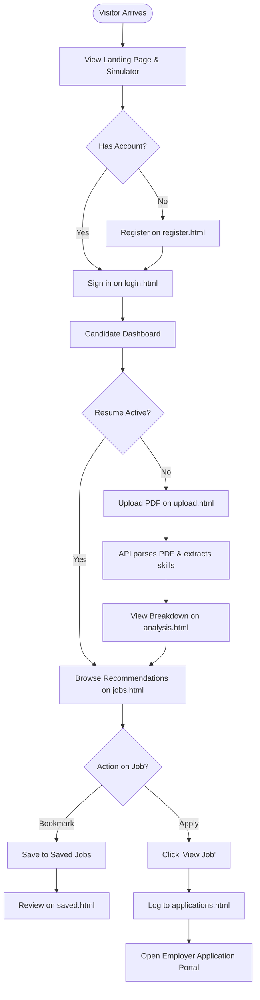

### Detailed Step-by-Step Journeys

#### Journey 1: Candidate Onboarding & Authentication
1. **Visitor Landing:** User navigates to `http://127.0.0.1:3000/`. They view hero metrics and test the client-side parsing simulator.
2. **Registration:** User clicks "Get Started" and enters full name, email, and password on `register.html`.
3. **Password Validation:** Client-side meter scores complexity. User checks "Terms & Conditions" and submits.
4. **State Storage:** `auth.js` writes `{ name, email, role: 'Candidate' }` to `localStorage.nexstepUserProfile` and redirects to `login.html`.
5. **Sign In:** User enters email and password on `login.html`. On submit, session starts and user is routed to `dashboard.html`.

#### Journey 2: Resume PDF Parsing & Skill Extraction
1. **Dashboard Prompt:** On `dashboard.html`, candidate sees "No resume uploaded yet" badge and clicks "Upload Resume".
2. **File Selection:** On `upload.html`, candidate drags and drops a PDF resume (e.g. `Resume.pdf`).
3. **Format & Size Check:** `upload.js` verifies file extension (`.pdf`) and size (<= 10 MB).
4. **API Ingestion:** Candidate clicks "Continue to Analysis". `upload.js` sends multipart `POST /api/analyze` to `http://127.0.0.1:5000/api/analyze`.
5. **Server Extraction:** `app.py` extracts text via `pypdf`, extracts contact info, skills, education, and experience, evaluates alignment using the ML model, and returns a JSON payload.
6. **State Sync:** `upload.js` saves the payload into `sessionStorage.nexstepAnalysis` and `localStorage.nexstepAnalysis`, logging an activity event.
7. **Breakdown Display:** User is redirected to `analysis.html`, which displays detected skills chips, timeline snippets, and probability breakdown cards.

#### Journey 3: Match Evaluation & Career Recommendations
1. **Navigating to Matches:** From `analysis.html` or the sidebar, candidate clicks "Recommendations" (`jobs.html`).
2. **Recommendation Request:** `jobs.js` extracts candidate resume text from state and sends a `POST /api/recommendations` request to port 5000.
3. **Aggregation & Scoring:** Backend queries `job_service.py` (which returns 40 jobs from Greenhouse and Lever), computes TF-IDF cosine similarity, applies keyword boost (+12% per matched skill), and ranks jobs by match score.
4. **Card Rendering:** `jobs.js` dynamically renders cards showing company, location, employment type, match score percentage, and fit classification.

#### Journey 4: Bookmark Management & External Application Tracking
1. **Bookmarking a Job:** Candidate clicks "Save Job" on a listing. `NexStepState.saveJob()` appends the job to `localStorage.nexstepSavedJobsList`. Button updates to "✓ Saved".
2. **Reviewing Saved Roles:** Candidate navigates to `saved.html` to review all bookmarked roles or remove ones no longer needed.
3. **Applying to a Job:** Candidate clicks "View Job". `NexStepState.recordApplication()` logs the job ID, title, company, location, URL, date, and time to `localStorage.nexstepApplicationsList`.
4. **External Portal Opened:** The browser opens the employer's official job board (e.g., `boards.greenhouse.io` or `jobs.lever.co`) in a new browser tab.
5. **Audit History:** Candidate navigates to `applications.html` to view their timestamped external application activity history.

---

## 10. Windows Setup, Execution & Troubleshooting Guide

### 10.1 System Prerequisites
- **Operating System:** Windows 10 or Windows 11 (64-bit)
- **Python:** Version `3.11.x` (Verified with Python `3.11.15`)
- **Shell:** Windows PowerShell 5.1+ or PowerShell Core 7+
- **Web Browser:** Google Chrome, Microsoft Edge, or Mozilla Firefox
- **Network Access:** Required to fetch live Greenhouse/Lever jobs (otherwise the app automatically falls back to local demo jobs)

---

### 10.2 Directory & Environment Verification
Ensure you are in the project root:
```powershell
cd d:\antigravity\NexStep
```

Verify virtual environment:
```powershell
Test-Path .\.venv\Scripts\python.exe
```

Activate the virtual environment in PowerShell:
```powershell
.\.venv\Scripts\Activate.ps1
```
*(If PowerShell shows an Execution Policy error, run: `Set-ExecutionPolicy -Scope Process -ExecutionPolicy Bypass`)*

---

### 10.3 Complete Dependency Installation
Install all required libraries into your virtual environment:
```powershell
.\.venv\Scripts\pip.exe install flask>=3.1.0 flask-cors>=6.0.0 joblib>=1.6.0 pypdf>=6.18.0 scikit-learn==1.6.1 numpy scipy
```

> [!TIP]
> Pinning `scikit-learn==1.6.1` is recommended because the serialized model artifacts (`nexstep_model.pkl` and `nexstep_tfidf.pkl`) were generated using version 1.6.1, preventing `InconsistentVersionWarning`.

---

### 10.4 Environment Variables Template (`.env`)
Create a file named `.env` in `Backend/` (or root):
```env
# NexStep Environment Configuration Template
FLASK_ENV=development
FLASK_DEBUG=1
PORT=5000

# Future Database Configuration (Safe Placeholders)
DB_HOST=127.0.0.1
DB_PORT=3306
DB_NAME=nexstep_db
DB_USER=nexstep_user
DB_PASSWORD=[REDACTED_LOCAL_DB_PASSWORD]

# Application Secret Key (for future session / JWT signing)
SECRET_KEY=[REDACTED_GENERATE_RANDOM_SECRET_KEY]
```

---

### 10.5 Starting the Application (Single Command)
Run the automated launcher script ([run.py](file:///d:/antigravity/NexStep/run.py)):
```powershell
python run.py
```
This script cleans up ports 3000 and 5000, starts the Flask Backend on port 5000, starts the Frontend static server on port 3000, and opens the landing page in your browser.

---

### 10.6 Starting Services Manually (Separate Terminals)

#### Terminal 1: Backend Service
```powershell
cd d:\antigravity\NexStep
.\.venv\Scripts\python.exe Backend/app.py
```
- Listens on: `http://127.0.0.1:5000/`

#### Terminal 2: Frontend Server
```powershell
cd d:\antigravity\NexStep
.\.venv\Scripts\python.exe -m http.server 3000 --directory Frontend
```
- Listens on: `http://127.0.0.1:3000/`

---

### 10.7 Troubleshooting & Common Startup Errors

| Issue | Cause | Resolution |
| :--- | :--- | :--- |
| `Address already in use` (Port 3000 or 5000) | A prior instance of Flask or Python is still running in the background. | Run `run.py` (which auto-kills zombie processes) or manually kill: <br>`powershell "Get-NetTCPConnection -LocalPort 3000, 5000 -ErrorAction SilentlyContinue \| ForEach-Object { Stop-Process -Id $_.OwningProcess -Force }"` |
| `InconsistentVersionWarning` on model load | Model was serialized with Scikit-Learn 1.6.1, but environment has 1.9.1. | This is non-fatal; inference works. To suppress: `pip install scikit-learn==1.6.1` |
| `ModuleNotFoundError: No module named 'flask_cors'` | Incomplete dependencies installed in virtual environment. | Run: `.\.venv\Scripts\pip.exe install flask-cors joblib pypdf scikit-learn` |
| `Script execution disabled on this system` | PowerShell ExecutionPolicy default restriction (`Restricted`). | Run: `Set-ExecutionPolicy -Scope Process -ExecutionPolicy Bypass` |
| 404 error on `favicon.ico` in browser console | The file `Frontend/favicon.ico` does not exist in the repository. | This is cosmetic and does not affect app functionality. Add a 32x32 `.ico` to `Frontend/`. |
| Greenhouse / Lever fetch timeout | Slow network or external API temporary throttling. | `Backend/job_service.py` automatically falls back to local `jobs.json` within 5 seconds without crashing. |

---

## 11. Authentication, Security & Configuration

### 11.1 Current Authentication State
Authentication is currently handled entirely on the client side in [Frontend/js/auth.js](file:///d:/antigravity/NexStep/Frontend/js/auth.js). There is no server-side user table, password hashing, or token verification.

### 11.2 Security Vulnerabilities & Technical Risks
1. **Client-Side Auth Bypass:** Because authentication checks are client-side only, any user can bypass login and directly visit `dashboard.html` or `jobs.html`.
2. **Plaintext Password Handling:** Passwords typed during registration or login are not hashed with bcrypt or Argon2; they are validated in JavaScript regex and discarded without server persistence.
3. **Debug Server Exposure:** Flask is configured with `debug=True` and bound to `0.0.0.0` ([Backend/app.py:353-356](file:///d:/antigravity/NexStep/Backend/app.py#L353-L356)), which exposes the interactive Werkzeug debugging console. In a production environment, this should be disabled.
4. **Hardcoded URLs:** [Frontend/js/config.js](file:///d:/antigravity/NexStep/Frontend/js/config.js) hardcodes `http://127.0.0.1:5000`, which will fail if deployed across custom domains without updating the file.

### 11.3 Positive Security Measures in Place
- **XSS Sanitization:** [Frontend/js/state.js:18-21](file:///d:/antigravity/NexStep/Frontend/js/state.js#L18-L21) implements `sanitizeText()` to strip HTML script tags and injection strings from user profile names.
- **HTML Escaping:** All dynamic job card renderers use `escapeHtml()` to neutralize potential cross-site scripting in employer titles and descriptions.
- **Upload Restrictions:** [Backend/app.py:195-203](file:///d:/antigravity/NexStep/Backend/app.py#L195-L203) rejects non-PDF files and enforces a strict 10 MB file size limit.

---

## 12. Testing, Verification & Quality Report

### 12.1 Automated Test Suite Audit
- **Existing Automated Test Framework:** **None.**
- **Existing Test Files:** 0 test files found in repository.
- **Coverage Status:** 0% automated code coverage.

---

### 12.2 Non-Destructive Tests Performed During Inspection

#### Test Case 1: Environment & Dependency Verification
- **Command:** `python.exe -m pip list`
- **Status:** **PASS**
- **Findings:** Python `3.11.15`, Flask `3.1.3`, Scikit-Learn `1.9.1`, PyPDF `6.18.1`, Joblib `1.6.0`, NumPy `2.4.6`.

#### Test Case 2: Machine Learning Artifact Deserialization
- **Component:** `nexstep_model.pkl`, `nexstep_tfidf.pkl`, `nexstep_classes.pkl`
- **Status:** **PASS (With Warning)**
- **Findings:** Model architecture is `LogisticRegression(class_weight='balanced', max_iter=1000, solver='liblinear')`. Vocabulary size is 200,000. Warning emitted due to Scikit-Learn 1.6.1 vs 1.9.1 mismatch.

#### Test Case 3: Backend Health API Endpoint
- **Route:** `GET /` on `http://127.0.0.1:5000/`
- **Status:** **PASS (200 OK)**
- **Response Received:**
  ```json
  {
    "message": "NexStep backend is running",
    "model_classes": ["Good Fit", "No Fit", "Potential Fit"],
    "status": "success"
  }
  ```

#### Test Case 4: Job Service Aggregation & Public API Ingestion
- **Route:** `GET /api/jobs` on `http://127.0.0.1:5000/api/jobs`
- **Status:** **PASS (200 OK)**
- **Findings:** Ingested 40 live public job postings from Greenhouse and Lever. In-memory caching works; fallback to `jobs.json` verified.

#### Test Case 5: ML Resume-to-Job Matching Engine
- **Route:** `POST /api/recommendations`
- **Payload:** `{ "resume": "Software developer with 3 years Python, Flask, SQL, React and Git experience", "top_n": 3 }`
- **Status:** **PASS (200 OK)**
- **Findings:** Evaluated 40 opportunities and returned ranked matches with fit class and percentage.

#### Test Case 6: Raw Prediction Classifier
- **Route:** `POST /api/predict`
- **Status:** **PASS (200 OK)**
- **Findings:** Evaluated text string and returned probability distribution across classes.

#### Test Case 7: Frontend Static Server Execution
- **Command:** `python.exe -m http.server 3000 --directory Frontend`
- **Status:** **PASS (200 OK)**

#### Test Case 8: Headless Browser Rendering & Screenshot Capture
- **Component:** Google Chrome Headless
- **Status:** **PASS (All 9 pages rendered successfully)**

---

### 12.3 Recommended Automated Test Suite Structure
```text
tests/
├── conftest.py                # Shared fixtures (Flask test client, mock PDF, mock job payloads)
├── test_health.py             # Verifies GET / status and model_classes
├── test_jobs_api.py           # Verifies GET /api/jobs and GET /api/jobs/<id>
├── test_predict_api.py        # Verifies POST /api/predict validation and probabilities
├── test_analyze_api.py        # Verifies POST /api/analyze with valid and invalid PDFs
├── test_recommendations.py    # Verifies POST /api/recommendations scoring and ranking
├── test_nlp_extraction.py     # Unit tests for clean_text_utf8, extract_skills, extract_contact
└── test_job_service.py        # Unit tests for Greenhouse, Lever, and local fallback caching
```

---

## 13. Current Development Status

The table below summarizes the implementation status of all discovered components:

| Feature / Component | Status | Evidence in Codebase | Remaining Work | Priority |
| :--- | :--- | :--- | :--- | :--- |
| **Landing Page & Simulator** | **Implemented** | [Frontend/index.html](file:///d:/antigravity/NexStep/Frontend/index.html), [script.js](file:///d:/antigravity/NexStep/Frontend/js/script.js) | Connect simulator to live backend instead of mock data. | Low |
| **Candidate Auth UI** | **Implemented** | [Frontend/login.html](file:///d:/antigravity/NexStep/Frontend/login.html), [register.html](file:///d:/antigravity/NexStep/Frontend/register.html), [auth.js](file:///d:/antigravity/NexStep/Frontend/js/auth.js) | None on UI; backend needed. | Medium |
| **Backend Authentication API** | **Not Implemented** | No auth endpoints in [Backend/app.py](file:///d:/antigravity/NexStep/Backend/app.py) | Create `/api/auth/register`, `/api/auth/login`, bcrypt hashing, JWT issuance. | **High** |
| **Candidate Dashboard** | **Implemented** | [Frontend/dashboard.html](file:///d:/antigravity/NexStep/Frontend/dashboard.html), [dashboard.js](file:///d:/antigravity/NexStep/Frontend/js/dashboard.js) | Unify theme tokens. | Low |
| **PDF Resume Parsing** | **Implemented** | [Backend/app.py:186-256](file:///d:/antigravity/NexStep/Backend/app.py#L186-L256), [upload.js](file:///d:/antigravity/NexStep/Frontend/js/upload.js) | Add support for DOCX resumes; persist files to disk. | Medium |
| **ML Resume Alignment Model** | **Implemented** | [Backend/nexstep_model.pkl](file:///d:/antigravity/NexStep/Backend/nexstep_model.pkl), [nexstep_tfidf.pkl](file:///d:/antigravity/NexStep/Backend/nexstep_tfidf.pkl) | Reserialize under scikit-learn 1.9.1 to resolve warnings. | **High** |
| **ML Training Pipeline** | **Not Implemented** | [ML/.gitkeep](file:///d:/antigravity/NexStep/ML/.gitkeep) is empty | Commit training scripts and raw dataset to `ML/`. | Medium |
| **Job Aggregator (Live APIs)** | **Implemented** | [Backend/job_service.py](file:///d:/antigravity/NexStep/Backend/job_service.py), `job_sources/` | Add additional job boards and search filters. | Medium |
| **Job Recommendations Engine** | **Implemented** | [Backend/app.py:262-346](file:///d:/antigravity/NexStep/Backend/app.py#L262-L346), [jobs.js](file:///d:/antigravity/NexStep/Frontend/js/jobs.js) | Add keyword search and location filter UI. | Medium |
| **Job Bookmarking (Saved)** | **Implemented (Local)**| [Frontend/saved.html](file:///d:/antigravity/NexStep/Frontend/saved.html), [saved.js](file:///d:/antigravity/NexStep/Frontend/js/saved.js) | Migrate storage from `localStorage` to MySQL database. | **High** |
| **Application Click Tracking** | **Implemented (Local)**| [Frontend/applications.html](file:///d:/antigravity/NexStep/Frontend/applications.html), [applications.js](file:///d:/antigravity/NexStep/Frontend/js/applications.js) | Migrate storage from `localStorage` to MySQL database. | **High** |
| **Relational Database (MySQL)**| **Not Implemented** | [Database/.gitkeep](file:///d:/antigravity/NexStep/Database/.gitkeep) is empty | Implement SQLAlchemy models, connection pool, and migrations. | **High** |
| **Automated Testing Suite** | **Not Implemented** | 0 test files in repository | Implement pytest unit and integration test suite. | **High** |

---

## 14. Bugs, Code Inconsistencies & Technical Debt

### Confirmed Bugs
1. **Incomplete Dependencies in `requirements.txt`:** [Backend/requirements.txt:1](file:///d:/antigravity/NexStep/Backend/requirements.txt#L1) only specifies `flask>=3.0.0`. It fails to include `flask-cors`, `joblib`, `pypdf`, `scikit-learn`, `numpy`, and `scipy`.
2. **Missing `favicon.ico`:** Browsers generate 404 errors on every page navigation because `Frontend/favicon.ico` is missing.
3. **Scikit-Learn Version Warning:** Loading `nexstep_model.pkl` produces an `InconsistentVersionWarning` on startup because it was serialized with version 1.6.1 and loaded in 1.9.1.
4. **Unconditional Browser Pop-Up:** [run.py:55](file:///d:/antigravity/NexStep/run.py#L55) unconditionally invokes `webbrowser.open()`, opening a browser tab even during automated or headless executions.

### Technical Debt & Code Inconsistencies
1. **CSS Layout Class Inconsistency:** [Frontend/saved.html](file:///d:/antigravity/NexStep/Frontend/saved.html) and [Frontend/applications.html](file:///d:/antigravity/NexStep/Frontend/applications.html) use legacy class names (`dashboard-container`, `sidebar`) instead of the modernized `dash-shell` and `dash-sidebar` used across `dashboard.html`, `upload.html`, and `jobs.html`.
2. **Hardcoded API URL:** [Frontend/js/config.js:6](file:///d:/antigravity/NexStep/Frontend/js/config.js#L6) hardcodes `http://127.0.0.1:5000`.
3. **Debug Mode Enabled on `0.0.0.0`:** [Backend/app.py:353-356](file:///d:/antigravity/NexStep/Backend/app.py#L353-L356) launches Flask in debug mode listening on all interfaces.
4. **Missing Training Pipeline:** The `ML/` directory contains no code or datasets explaining how the TF-IDF vectorizer and Logistic Regression models were generated.

---

## 15. Prioritized Development Continuation Roadmap

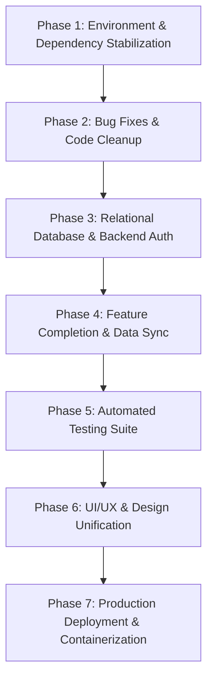

### Phase 1 — Environment & Dependency Stabilization (High Priority)
- **T1.1:** Update [Backend/requirements.txt](file:///d:/antigravity/NexStep/Backend/requirements.txt) with all 7 packages.
- **T1.2:** Pin `scikit-learn==1.6.1` or re-export models to resolve startup warnings.
- **T1.3:** Add `.env` support via `python-dotenv`.

### Phase 2 — Bug Fixes & Code Cleanup (Medium Priority)
- **T2.1:** Add missing `Frontend/favicon.ico`.
- **T2.2:** Add `--no-browser` option to `run.py`.
- **T2.3:** Unify sidebar CSS across `saved.html` and `applications.html`.
- **T2.4:** Make `config.js` API URL dynamically detect host.

### Phase 3 — Relational Database & Backend Authentication (High Priority)
- **T3.1:** Implement SQLAlchemy models for `User`, `Resume`, `Job`, `SavedJob`, `Application`.
- **T3.2:** Implement `POST /api/auth/register` (with bcrypt) and `POST /api/auth/login` (with JWT).
- **T3.3:** Connect `auth.js` and `state.js` to the backend auth API.

### Phase 4 — Feature Completion & Data Sync (High Priority)
- **T4.1:** Implement server-side resume persistence in `uploads/`.
- **T4.2:** Implement database endpoints for saved jobs and application logs.
- **T4.3:** Commit standalone model training script to `ML/train.py`.

### Phase 5 — Automated Testing Suite (High Priority)
- **T5.1:** Build `pytest` test suite covering API endpoints and NLP parsing with >80% coverage.
- **T5.2:** Implement headless browser UI smoke tests.

### Phase 6 — UI/UX Refinements (Medium Priority)
- **T6.1:** Add keyword search and location filter UI on `jobs.html`.
- **T6.2:** Replace JavaScript `alert()` with non-blocking toast notifications.

### Phase 7 — Production Deployment & DevOps (Low Priority)
- **T7.1:** Configure production WSGI server (`Waitress` or `Gunicorn`).
- **T7.2:** Create `Dockerfile` and `docker-compose.yml`.

---

## 16. First Session Guide: Exact Resumption Task

### Recommended Exact First Task: **Update `Backend/requirements.txt` & Stabilize Dependencies**

#### Why This Must Be Done First:
Before writing new features or configuring a database, the project's dependency manifest must reflect the actual requirements of the codebase. Currently, anyone who clones the repository and follows standard Python setup (`pip install -r Backend/requirements.txt`) will have a broken environment missing `flask-cors`, `joblib`, `pypdf`, and `scikit-learn`.

#### Step-by-Step Instructions:
1. Update [Backend/requirements.txt](file:///d:/antigravity/NexStep/Backend/requirements.txt) to include:
   ```text
   flask>=3.1.0
   flask-cors>=6.0.0
   joblib>=1.6.0
   pypdf>=6.18.0
   scikit-learn==1.6.1
   numpy>=1.26.0
   scipy>=1.14.0
   python-dotenv>=1.0.0
   ```
2. Run the single-command runner to verify clean startup:
   ```powershell
   python run.py
   ```
3. Confirm that the terminal outputs clean startup messages without `InconsistentVersionWarning` or missing module errors, and query `http://127.0.0.1:5000/` to ensure 200 OK.

---

## 17. Project Glossary

- **ATS (Applicant Tracking System):** Software used by employers to collect, sort, and rank job applicants.
- **Bcrypt:** A password-hashing function designed to protect stored passwords against brute-force attacks.
- **CORS (Cross-Origin Resource Sharing):** A browser security mechanism that restricts HTTP requests initiated from a domain/port different from the resource host.
- **Greenhouse:** A popular commercial ATS whose public job board API is queried by NexStep to fetch live employer postings.
- **In-Memory Stream:** Processing uploaded file bytes directly in RAM without writing temporary files to the hard drive.
- **JWT (JSON Web Token):** A compact, URL-safe standard for transmitting claims securely between a client and a server for user authentication.
- **Lever:** A modern recruitment platform and ATS whose public postings API is queried by NexStep.
- **LocalStorage:** A browser Web Storage API that stores key-value pairs persistently with no expiration date.
- **Logistic Regression:** A supervised machine learning classification algorithm that calculates the probability of an input belonging to a specific class.
- **PyPDF:** A pure-Python library used in NexStep to extract text and page metadata from PDF documents.
- **SessionStorage:** A browser Web Storage API that persists data only for the duration of the current browser tab session.
- **TF-IDF (Term Frequency-Inverse Document Frequency):** A numerical statistic that reflects how important a word is to a document within a broader collection.
- **WSGI (Web Server Gateway Interface):** The universal specification for Python web applications to communicate with web servers.

---

## 18. Final Project Summary

### What Currently Exists
NexStep has a functional, attractive frontend user interface spanning 9 web pages and an operational Flask backend API. The machine learning pipeline successfully deserializes and evaluates candidate resume text against job descriptions, and the live job aggregation service successfully pulls and normalizes real-world software positions from Greenhouse and Lever APIs.

### What Works
- Single-command orchestration via `python run.py`.
- In-memory PDF resume text and technical skill extraction.
- TF-IDF + Logistic Regression match scoring (0–98%).
- Live public job ingestion with automatic local fallback.
- LocalStorage bookmarking of jobs and external application click tracking.
- Client-side form validation and interactive landing page simulation.

### What Remains Incomplete
- **No Database:** MySQL is planned but completely unbuilt.
- **No Server Authentication:** Login and registration are client-side only.
- **No Server-Side File Storage:** Uploaded resumes are not saved on the server.
- **Incomplete Requirements Manifest:** `requirements.txt` lacks 6 dependencies.
- **No Automated Tests:** The repository contains zero automated test suites.

### How to Resume Development Safely
1. Keep existing code untouched while reviewing this unified master document.
2. Follow the prioritized steps in [Section 15 (Prioritized Development Continuation Roadmap)](#15-prioritized-development-continuation-roadmap).
3. Update `Backend/requirements.txt` first, then proceed to Phase 2 and Phase 3 (database and backend authentication).
